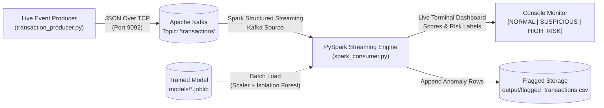

# Real-Time AI Streaming: Fraud Detection Pipeline

A production-grade, local streaming architecture for real-time credit card and banking transaction fraud detection. This project demonstrates high-throughput event ingestion via **Apache Kafka**, distributed stream processing with **Apache Spark Structured Streaming (PySpark)**, and unsupervised machine-learning anomaly detection using **scikit-learn's Isolation Forest**.

---

## 1. System Architecture

The end-to-end pipeline ingests live financial events, processes micro-batches with Spark, scores behavioral anomalies using a pre-trained ML model, prints real-time alerts to the console, and persistently stores suspicious transactions for human review.



### Event Lifecycle & Pipeline Stages
1. **Event Simulation & Production (`transaction_producer.py`)**:
   Generates synthetic JSON transaction events with realistic amounts, geographical distances, transaction velocity frequencies, and merchant categories. Publishes each event to the Kafka topic `transactions` keyed by `customer_id`.
2. **Message Broker (`Apache Kafka / KRaft`)**:
   A single-node Kafka broker operating in modern KRaft mode (no Zookeeper required) acting as an event buffer.
3. **Structured Streaming Engine (`spark_consumer.py`)**:
   PySpark subscribes to the Kafka topic, parses the JSON payload into structured DataFrames with explicit data types, and triggers micro-batches every 2 seconds.
4. **ML Inference (`models/fraud_detection_pipeline.joblib`)**:
   Applies standardized preprocessing (`StandardScaler`) and runs scikit-learn's `IsolationForest` decision function. Computes an anomaly score, flags outliers (`-1` vs `+1`), and classifies records into risk tiers:
   - `NORMAL`: Standard behavioral pattern
   - `SUSPICIOUS`: Mild statistical deviation or borderline anomaly
   - `HIGH_RISK`: Extreme outlier (high dollar value, velocity burst, or impossible geographic displacement)
5. **Real-Time Display & Persistence**:
   Outputs a color-coded batch summary table to the terminal and automatically appends flagged records (`SUSPICIOUS` and `HIGH_RISK`) to `output/flagged_transactions.csv`.

---

## 2. Technology Stack

| Technology | Version | Purpose |
| :--- | :--- | :--- |
| **Python** | 3.11.x | Core programming language |
| **Apache Kafka** | 3.7.0 (KRaft) | Distributed event streaming broker |
| **Apache Spark / PySpark** | 3.5.1 | Distributed real-time stream processing |
| **Kafka Spark Connector** | `spark-sql-kafka-0-10_2.12:3.5.1` | Native Spark-to-Kafka streaming integration |
| **Java JDK** | OpenJDK 21 LTS | Runtime environment for Spark & JVM |
| **scikit-learn** | >= 1.4.0 | Isolation Forest anomaly detection algorithm |
| **pandas & NumPy** | Modern LTS | Numerical operations and CSV persistence |
| **joblib** | >= 1.3.0 | ML model serialization and loading |
| **Docker Compose** | v2.x / v5.x | Containerized local Kafka deployment |

---

## 3. Project Directory Structure

```text
Realtime-fraud-detection/
├── docker-compose.yml             # Single-node Kafka KRaft container definition
├── requirements.txt               # Pinned Python dependencies
├── README.md                      # Architecture documentation and reproduction runbook
├── .gitignore                     # Git ignore rules for checkpoints, models, data, and cache
├── train_model.py                 # Generates synthetic data, trains & serializes Isolation Forest
├── transaction_producer.py        # Real-time event generator publishing to Kafka
├── spark_consumer.py              # PySpark Structured Streaming consumer & ML evaluator
├── tests/
│   └── test_pipeline.py           # Unit and integration test suite
├── models/                        # Serialized model bundle (.joblib)
├── data/                          # Training dataset (.csv)
├── output/                        # Flagged suspicious transactions (.csv)
└── checkpoints/                   # Spark Structured Streaming state checkpoints
```

---

## 4. Machine-Learning Model Details

### Features
The Isolation Forest model trains on five canonical features:
1. `amount` *(float)*: Monetary value of the transaction in USD.
2. `transaction_hour` *(int, 0–23)*: Hour of the day the transaction occurred.
3. `distance_from_home_km` *(float)*: Distance in kilometers between the cardholder billing address and the transaction merchant location.
4. `transaction_frequency_1h` *(int)*: Number of transactions conducted by this account within the last 60 minutes.
5. `merchant_risk_score` *(float, 0.0–1.0)*: Historical risk assessment score associated with the merchant.

### Transformation & Model Architecture
- **Standardization**: Features are scaled using `StandardScaler` to ensure features with differing magnitudes (e.g. `amount` vs `merchant_risk_score`) contribute proportionally to tree splits.
- **Algorithm**: `IsolationForest(n_estimators=150, contamination=0.04, random_state=42)`.
- **Inference Metric**: The model's `decision_function` produces continuous outlier scores. Negative values represent anomalies, while lower scores denote more extreme deviations.
- **Distinction between Anomaly vs Fraud**: Anomaly detection identifies *unusual statistical patterns* (e.g. an unexpected large purchase or international travel). In real-world banking, an anomaly triggers step-up authentication or a hold, but is not confirmed fraud until verified through cardholder confirmation or dispute resolution.

> **Data Limitation Note**: The training and demonstration datasets use synthetic distributions designed to replicate genuine banking transaction behavior. Metrics reported on synthetic data serve as baseline sanity checks and do not represent production performance on real-world bank data.

---

## 5. Prerequisites & Environment Setup

### 1. Prerequisites
- **Windows 10/11** with PowerShell.
- **Python 3.11** installed.
- **Java OpenJDK 21 LTS** or **Java 17 / 11**.
- **Docker Desktop** installed and running (for Apache Kafka).

### 2. Virtual Environment Setup
Open Windows PowerShell in the project root:

```powershell
# Create Python 3.11 virtual environment
py -3.11 -m venv .venv

# Activate the virtual environment
.\.venv\Scripts\Activate.ps1

# Upgrade pip and install required dependencies
pip install -r requirements.txt
```

---

## 6. Execution Runbook (Step-by-Step)

Follow these exact steps in order.

### Step 1: Start Apache Kafka via Docker Compose
In a PowerShell terminal:

```powershell
# Start single-node Kafka broker in KRaft mode
docker compose up -d

# Verify container status
docker ps
```

Verify that the `fraud-detection-kafka` container is healthy and listening on port `9092`.

*(Optional)* Create or verify the Kafka topic:
```powershell
docker exec -i fraud-detection-kafka /opt/kafka/bin/kafka-topics.sh --bootstrap-server localhost:9092 --create --if-not-exists --topic transactions --partitions 2 --replication-factor 1
```

### Step 2: Train the Anomaly Detection Model
Generate the synthetic training set, fit the Isolation Forest model, evaluate baseline metrics, and serialize the pipeline:

```powershell
.\.venv\Scripts\python.exe train_model.py --samples 15000 --contamination 0.04
```

Expected output:
- Generates `data/synthetic_transactions.csv` (15,000 records).
- Evaluates confusion matrix and ROC-AUC score.
- Saves model bundle to `models/fraud_detection_pipeline.joblib`.

### Step 3: Run the Test Suite
Verify that all components, feature mappings, and serializers function properly:

```powershell
.\.venv\Scripts\pytest -v tests/test_pipeline.py
```

### Step 4: Start the Spark Structured Streaming Consumer
Open a **new PowerShell terminal** (Terminal 1):

```powershell
.\.venv\Scripts\Activate.ps1
$env:JAVA_HOME = "C:\Program Files\Android\openjdk\jdk-21.0.8"
.\.venv\Scripts\python.exe spark_consumer.py --trigger-interval "2 seconds"
```

The consumer will:
- Download the Spark-Kafka connector (cached on subsequent runs).
- Load `models/fraud_detection_pipeline.joblib`.
- Subscribe to Kafka topic `transactions`.
- Display a waiting banner for incoming transactions.

### Step 5: Start the Live Transaction Producer
Open a **second PowerShell terminal** (Terminal 2):

```powershell
.\.venv\Scripts\Activate.ps1
.\.venv\Scripts\python.exe transaction_producer.py --interval 1.0 --anomaly-rate 0.18
```

You will observe:
- Events continuously published to Kafka topic `transactions`.
- Terminal 1 (Spark consumer) rendering micro-batch tables with real-time predictions (`NORMAL`, `? SUSPICIOUS`, `! HIGH_RISK !`).
- Flagged suspicious transactions automatically recorded in `output/flagged_transactions.csv`.

*(Optional)* To run a finite demonstration of 25 transactions and stop automatically:
```powershell
.\.venv\Scripts\python.exe transaction_producer.py --interval 0.5 --max-events 25 --anomaly-rate 0.25
```

---

## 7. Inspecting Kafka and Results

### Inspect Kafka Messages Directly
To verify that raw JSON messages are genuinely flowing through Kafka:
```powershell
docker exec -i fraud-detection-kafka /opt/kafka/bin/kafka-console-consumer.sh --bootstrap-server localhost:9092 --topic transactions --from-beginning --max-messages 5
```

### Inspect Flagged Output CSV
In PowerShell:
```powershell
Get-Content output\flagged_transactions.csv | Select-Object -First 10
```

---

## 8. Troubleshooting

| Symptom | Cause | Solution |
| :--- | :--- | :--- |
| `java.lang.IllegalArgumentException: Unsupported class file major version` | PySpark ran with Java 26+ | Set `$env:JAVA_HOME = "C:\Program Files\Android\openjdk\jdk-21.0.8"` before launching Spark. |
| `NoBrokersAvailable` in producer | Kafka container not ready | Wait 10-15 seconds for Kafka container to pass health checks, or restart with `docker compose restart`. |
| `Failed to load model file` | Model not trained yet | Run `python train_model.py` first to create `models/fraud_detection_pipeline.joblib`. |
| Spark Kafka download timeout | Slow Maven mirror | Pre-download packages or allow Spark 1–2 minutes on first run to populate local Ivy cache. |
| Checkpoint lock conflict | Previous interrupted run | Delete `checkpoints/spark_fraud_stream` or start with a fresh checkpoint folder. |

---

## 9. Future Enhancements
1. **Supervised & Hybrid Models**: Integrate XGBoost or LightGBM alongside Isolation Forest when labeled fraud datasets (e.g. Kaggle Credit Card Fraud dataset) are available.
2. **Stateful Stream Processing**: Use Spark's `mapGroupsWithState` to compute rolling 24-hour sliding window aggregations (e.g. cumulative customer spend in past 10 minutes).
3. **Web Dashboard**: Connect output to Grafana or a Streamlit UI for executive-level fraud monitoring and alert resolution workflows.

