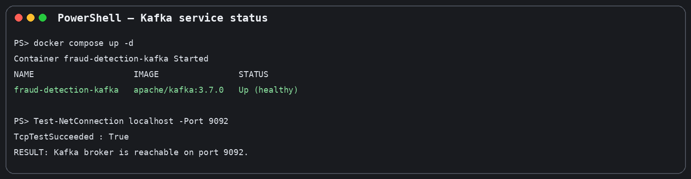
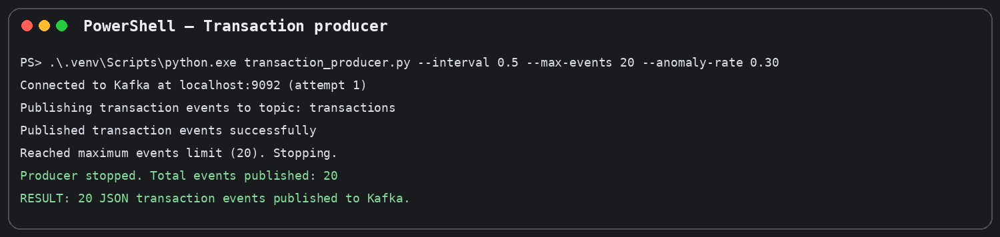
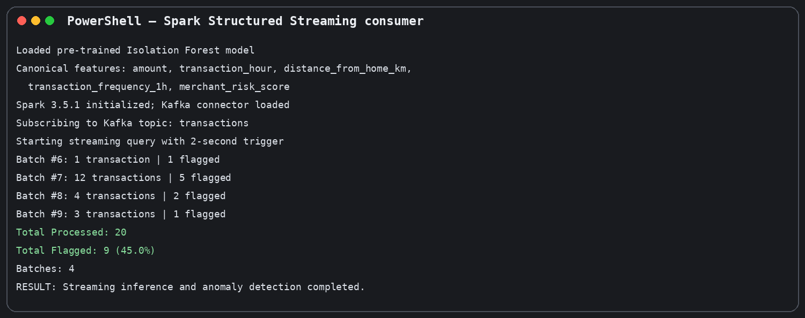
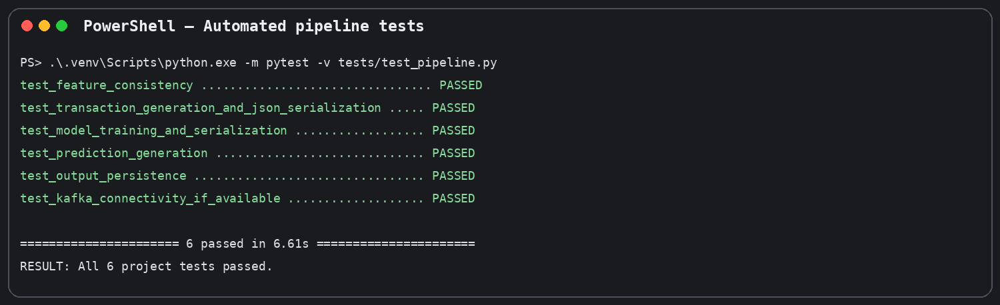

# Real-Time AI Streaming: Fraud Detection

A real-time transaction anomaly-detection pipeline built with **Apache Kafka**, **Apache Spark Structured Streaming**, and a pre-trained **Isolation Forest** model from Scikit-learn.

The project demonstrates how transaction events can be generated, streamed through Kafka, processed in Spark micro-batches, scored by a machine-learning model, and written to a CSV output file for further review.

> **Project status:** End-to-end demo executed successfully. In the verified run, the producer published 20 transactions, Spark processed all 20 in 4 micro-batches, 9 transactions were flagged as anomalies, and all 6 automated tests passed.
>
> **Important:** This is an educational demonstration using synthetic transaction data. An anomaly is a potential risk signal, not proof of fraud. The model has not been validated for production banking use.

---

## Table of Contents

- [1. Project Overview](#1-project-overview)
- [2. Architecture and Workflow](#2-architecture-and-workflow)
- [3. Technology Stack](#3-technology-stack)
- [4. Project Structure](#4-project-structure)
- [5. How the Detection Works](#5-how-the-detection-works)
- [6. Prerequisites](#6-prerequisites)
- [7. Installation and Setup](#7-installation-and-setup)
- [8. Run the Project](#8-run-the-project)
- [9. View the Results](#9-view-the-results)
- [10. Run Automated Tests](#10-run-automated-tests)
- [11. Example Execution Results](#11-example-execution-results)
- [12. Configuration](#12-configuration)
- [13. Troubleshooting](#13-troubleshooting)
- [14. Limitations and Responsible Use](#14-limitations-and-responsible-use)
- [15. Future Improvements](#15-future-improvements)
- [16. Author](#16-author)

---

## 1. Project Overview

Financial systems process many transactions every second. Reviewing every transaction manually is difficult, so automated systems can help identify unusual transaction patterns for further investigation.

This project implements a small real-time streaming pipeline:

1. A Python producer generates synthetic financial transactions.
2. The producer sends each transaction as a JSON message to an Apache Kafka topic.
3. Spark Structured Streaming reads the messages from Kafka.
4. A pre-trained Isolation Forest model scores each transaction.
5. The system assigns a risk category and saves flagged records to a CSV file.

The goal is to demonstrate the integration of streaming infrastructure and machine learning inference in one end-to-end workflow.

## 2. Architecture and Workflow

```text
Synthetic Transaction Generator
            |
            | JSON events
            v
      Apache Kafka
      Topic: transactions
            |
            | Kafka Spark Connector
            v
 Spark Structured Streaming
       (micro-batches)
            |
            v
   Feature Preparation
            |
            v
 Pre-trained Isolation Forest
            |
            v
  Anomaly / Risk Classification
            |
       +----+----+
       |         |
       v         v
 Console Output  CSV Persistence
                 output/flagged_transactions.csv
```

### Main components

| Component | Responsibility |
|---|---|
| `train_model.py` | Creates synthetic training data, trains the Isolation Forest pipeline, and saves the model |
| `transaction_producer.py` | Generates transaction events and publishes them to Kafka |
| `spark_consumer.py` | Reads Kafka events with Spark, performs model inference, and persists flagged records |
| Apache Kafka | Acts as the distributed event broker |
| Spark Structured Streaming | Processes incoming events in micro-batches |
| Isolation Forest | Identifies records that differ from learned transaction patterns |
| CSV output | Stores flagged transaction records for inspection |

## 3. Technology Stack

- **Python 3.11.6** – application and producer code
- **Apache Kafka 3.7.0** – transaction event streaming
- **Docker Desktop / Docker Compose** – runs the Kafka broker
- **Apache Spark 3.5.1** – structured stream processing
- **PySpark** – Python API for Spark
- **Scikit-learn** – Isolation Forest anomaly-detection model
- **Pandas and NumPy** – data preparation
- **Joblib** – model serialization
- **Pytest** – automated tests

The Spark Kafka connector used by the application is:

`org.apache.spark:spark-sql-kafka-0-10_2.12:3.5.1`

## 4. Project Structure

The repository is expected to have the following layout:

```text
Realtime-fraud-detection/
│
├── data/
│   └── synthetic_transactions.csv
│
├── models/
│   └── fraud_detection_pipeline.joblib
│
├── output/
│   └── flagged_transactions.csv
│
├── checkpoints/
│   └── (Spark streaming checkpoint files)
│
├── tests/
│   └── test_pipeline.py
│
├── docs/
│   └── screenshots/
│       ├── 01_kafka_docker.png
│       ├── 02_producer.png
│       ├── 03_spark.png
│       └── 04_pytest.png
│
├── docker-compose.yml
├── requirements.txt
├── train_model.py
├── transaction_producer.py
├── spark_consumer.py
├── README.md
└── .gitignore
```

Generated files such as virtual environments, Spark checkpoints, caches, and large temporary logs should generally not be committed. The model and sample dataset may be committed only if their size and repository policy permit it.

## 5. How the Detection Works

### 5.1 Transaction features

The model uses these five features:

| Feature | Description |
|---|---|
| `amount` | Transaction amount |
| `transaction_hour` | Hour at which the transaction occurs |
| `distance_from_home_km` | Distance from the customer's usual/home location |
| `transaction_frequency_1h` | Number of transactions in the previous hour |
| `merchant_risk_score` | Synthetic risk score associated with the merchant |

The producer creates synthetic values for these fields and serializes each event as JSON before publishing it to Kafka.

### 5.2 Isolation Forest

Isolation Forest is an unsupervised anomaly-detection algorithm. It isolates observations by randomly selecting features and split values. Records that are easier to isolate from the rest of the data receive stronger anomaly indications.

In this project:

- The model is trained in advance by `train_model.py`.
- The trained preprocessing/model pipeline is saved with Joblib.
- The Spark consumer loads the saved model and applies it to incoming transaction records.
- Predictions are used to identify records that should be reviewed.

### 5.3 Risk labels

The application output uses labels such as:

- `NORMAL` – the model did not flag the transaction as anomalous.
- `SUSPICIOUS` – a risk label used by the application's scoring/classification logic.
- `HIGH_RISK` – a higher-risk label used by the application's scoring/classification logic.

These labels are application-level indicators. They should not be interpreted as a confirmed fraud verdict.

## 6. Prerequisites

Install or prepare the following before running the project:

1. **Windows 10/11** (the documented commands use PowerShell).
2. **Python 3.11.x**.
3. **Java 21** (or a Java version supported by the installed Spark distribution).
4. **Docker Desktop**, started and running.
5. **Git**.
6. Internet access for installing Python packages and downloading the Spark Kafka connector when Spark starts.

Check the installations:

```powershell
python --version
java -version
docker --version
docker compose version
git --version
```

The project was verified in a Windows environment with Python 3.11.6, Java 21, Kafka 3.7.0 and Spark 3.5.1.

## 7. Installation and Setup

### Step 1: Clone the repository

Open PowerShell and run:

```powershell
git clone https://github.com/YOUR_GITHUB_USERNAME/Realtime-fraud-detection.git
cd Realtime-fraud-detection
```

Replace `YOUR_GITHUB_USERNAME` with the GitHub account that owns the repository.

### Step 2: Create a virtual environment

```powershell
py -3.11 -m venv .venv
```

Activate it:

```powershell
.\.venv\Scripts\Activate.ps1
```

If PowerShell blocks activation for the current session, run:

```powershell
Set-ExecutionPolicy -Scope Process -ExecutionPolicy Bypass
.\.venv\Scripts\Activate.ps1
```

You can also run the environment's Python directly without activating it:

```powershell
.\.venv\Scripts\python.exe --version
```

### Step 3: Install Python dependencies

```powershell
python -m pip install --upgrade pip
pip install -r requirements.txt
```

### Step 4: Configure Java and Hadoop environment (Windows)

If Spark on your Windows setup requires explicit Java/Hadoop paths, configure them in the current PowerShell session. Update the paths to match your computer:

```powershell
$env:JAVA_HOME = "C:\Program Files\Android\openjdk\jdk-21.0.8"
$env:PATH = "$env:JAVA_HOME\bin;$env:PATH"
$env:HADOOP_HOME = "C:\hadoop"
$env:PATH = "$env:HADOOP_HOME\bin;$env:PATH"
```

Confirm Java is available:

```powershell
java -version
```

`JAVA_HOME` and `HADOOP_HOME` are machine-specific. Do not copy these example paths blindly if your installations are in different folders.

### Step 5: Train the model

Run this once to generate the synthetic training data and save the model:

```powershell
python train_model.py
```

Expected generated artifacts include:

```text
data/synthetic_transactions.csv
models/fraud_detection_pipeline.joblib
```

If the repository already includes a compatible trained model and sample data, you can use those artifacts instead of retraining.

## 8. Run the Project

Run the system using **three PowerShell terminals**. Keep Docker running while the producer and Spark consumer are active.

### Terminal 1: Start Kafka with Docker Compose

From the project root:

```powershell
docker compose up -d
```

Check the container:

```powershell
docker compose ps
```

The Kafka container should show a running/healthy status.

Check that Kafka's local port is reachable:

```powershell
Test-NetConnection localhost -Port 9092
```

Look for:

```text
TcpTestSucceeded : True
```

If the Kafka container is not running, inspect its logs:

```powershell
docker compose logs -f
```

### Terminal 2: Start the Spark streaming consumer

Open a second PowerShell window, navigate to the project folder, activate the virtual environment, and configure Java/Hadoop variables if required.

Run:

```powershell
cd path\to\Realtime-fraud-detection
.\.venv\Scripts\Activate.ps1
python spark_consumer.py
```

The consumer should initialize Spark, load the saved model, connect to Kafka, subscribe to the `transactions` topic, and wait for events.

**Start the consumer before the producer** so that you can watch the incoming events being processed.

### Terminal 3: Start the transaction producer

Open a third PowerShell window and navigate to the project root:

```powershell
cd path\to\Realtime-fraud-detection
.\.venv\Scripts\Activate.ps1
```

Start a finite demo of 20 transactions:

```powershell
python transaction_producer.py --interval 0.5 --max-events 20 --anomaly-rate 0.30
```

Parameter meanings:

| Parameter | Meaning |
|---|---|
| `--interval 0.5` | Wait approximately 0.5 seconds between generated events |
| `--max-events 20` | Stop after publishing 20 events |
| `--anomaly-rate 0.30` | Configure the producer to generate a 30% synthetic anomaly rate |

The exact command-line options are defined by the producer script. Use `python transaction_producer.py --help` if you want to inspect the options supported by your local version.

### Optional: Run the producer continuously

If the producer supports running without a maximum event count, use:

```powershell
python transaction_producer.py --interval 1 --anomaly-rate 0.20
```

Stop the producer or consumer with **Ctrl + C** when finished.

## 9. View the Results

### 9.1 Spark terminal

The Spark consumer terminal displays processed micro-batches, prediction results, and counts of flagged transactions.

### 9.2 CSV output

Open this file to inspect saved flagged records:

```text
output/flagged_transactions.csv
```

In PowerShell:

```powershell
Get-Content .\output\flagged_transactions.csv
```

To open it in Excel:

```powershell
Invoke-Item .\output\flagged_transactions.csv
```

The output includes transaction details and prediction-related fields produced by the application, such as anomaly indicator, risk label, anomaly score, and evaluation time.

### 9.3 Kafka topic messages (optional)

To inspect messages directly from Kafka, run:

```powershell
docker exec -it fraud-detection-kafka /opt/kafka/bin/kafka-console-consumer.sh --bootstrap-server localhost:9092 --topic transactions --from-beginning
```

Stop the console consumer with **Ctrl + C**.

### 9.4 Docker Desktop

Open Docker Desktop → **Containers**. The `fraud-detection-kafka` container represents the Kafka broker.

The producer, Spark consumer, and model inference run as local Python processes in this implementation. They are not separate Docker containers.

## 10. Run Automated Tests

From the project root, with the virtual environment active:

```powershell
python -m pytest -v tests/test_pipeline.py
```

Or run using the virtual environment directly:

```powershell
.\.venv\Scripts\python.exe -m pytest -v tests/test_pipeline.py
```

The verified test run reported:

```text
====================== 6 passed in 6.61s ======================
```

The test suite covers feature consistency, transaction generation and JSON serialization, model training and serialization, prediction generation, output persistence, and Kafka connectivity when available.

## 11. Example Execution Results

The documented end-to-end verification run produced the following results:

| Verification item | Observed result |
|---|---:|
| Kafka broker | Started and healthy |
| Kafka port | `9092` reachable |
| Transactions published | 20 |
| Transactions processed by Spark | 20 |
| Spark micro-batches | 4 |
| Transactions flagged as anomalies | 9 |
| Flagged percentage in this run | 45.0% |
| Automated tests | 6 passed |

The 45% flagged result is specific to this generated demonstration run. It is not a measured real-world fraud rate and should not be used as a model-performance claim.

### Execution evidence

**1. Kafka running in Docker**



**2. Producer publishing transaction events**



**3. Spark processing and anomaly detection**



**4. Automated tests**



> Evidence note: The images currently included in this documentation package are formatted terminal evidence panels reconstructed from the verified execution output available during report preparation. Replace them with original, unedited desktop screenshots from your own terminals before presenting them as raw screenshots.

## 12. Configuration

The main settings are controlled by the project scripts and Docker Compose file.

| Setting | Current documented value |
|---|---|
| Kafka bootstrap server | `localhost:9092` |
| Kafka topic | `transactions` |
| Kafka version | `3.7.0` |
| Spark version | `3.5.1` |
| Streaming trigger | 2 seconds |
| Model | Isolation Forest |
| Model file | `models/fraud_detection_pipeline.joblib` |
| Output file | `output/flagged_transactions.csv` |

If you change the Kafka address, topic, model path, or output path in the code, make sure the producer and consumer use matching configuration.

## 13. Troubleshooting

### Problem: Producer cannot connect to Kafka

**Possible message:**

```text
Failed to connect to Kafka at localhost:9092
```

**Try:**

```powershell
docker compose up -d
docker compose ps
Test-NetConnection localhost -Port 9092
```

Wait until the Kafka container is healthy before starting the producer.

### Problem: Spark cannot connect to Kafka

1. Confirm Kafka is running.
2. Confirm `localhost:9092` is reachable.
3. Check that the Spark consumer is using the same topic name: `transactions`.
4. Restart the consumer after Kafka is available.

### Problem: Model file not found

Run:

```powershell
python train_model.py
```

Confirm that this file exists:

```text
models/fraud_detection_pipeline.joblib
```

### Problem: Spark/Java startup errors on Windows

Check:

```powershell
java -version
echo $env:JAVA_HOME
echo $env:HADOOP_HOME
```

Correct the environment paths for your local Java and Hadoop installations.

### Problem: PowerShell cannot activate the virtual environment

Run:

```powershell
Set-ExecutionPolicy -Scope Process -ExecutionPolicy Bypass
.\.venv\Scripts\Activate.ps1
```

### Stop Kafka

When the demonstration is complete:

```powershell
docker compose down
```

This stops and removes the Compose containers. It does not delete your project source files.

## 14. Limitations and Responsible Use

- The transaction dataset is synthetic and is not a real bank transaction dataset.
- The model's anomaly predictions are not proof that a transaction is fraudulent.
- Synthetic test performance does not establish real-world accuracy, precision, recall, or financial risk reduction.
- Production use would require representative, legally obtained data, careful validation, monitoring, privacy controls, security review, and human investigation workflows.
- The current implementation runs Kafka in Docker while the producer and Spark consumer run locally. It is not a fully containerized deployment.

## 15. Future Improvements

- Add a dashboard for live transaction and anomaly monitoring.
- Evaluate the model on a suitable real-world or properly governed benchmark dataset.
- Add precision, recall, F1-score, ROC-AUC, and confusion-matrix reporting on a valid labelled test set.
- Add schema validation and dead-letter handling for malformed events.
- Containerize the producer and Spark consumer for reproducible deployment.
- Add structured logging, metrics, and alerting.
- Add secure configuration for credentials and deployment environments.

## 16. Author

**Srushti Nawghane**

Academic project: Real-Time AI Streaming – Fraud Detection

---

If you find this project useful for learning about streaming systems and anomaly detection, feel free to explore the code, run the demo, and suggest improvements.
